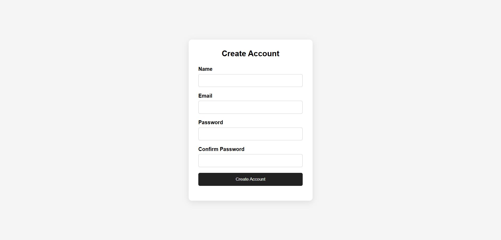

# Form Validation

A simple and responsive Form Validation project built with HTML, CSS, and JavaScript. This project was created to practice validating user input, handling form events, and displaying clear feedback before form submission.

---

## 🌟 Live Demo

[View Live Demo](https://roghayem.github.io/form-validation/)

---

## 🖼️ Preview



---

## ✨ Features

- Validate user input
- Display error messages for invalid fields
- Check required fields
- Validate email format
- Validate password input
- Display a success state for valid inputs
- Responsive design
- Clean and simple user interface

---

## 🛠️ Built With

- HTML5
- CSS3
- JavaScript (ES6)
- DOM Manipulation
- JavaScript Events
- Regular Expressions
- CSS Flexbox
- Media Queries

---

## 🚀 Getting Started

To run this project locally:

1. Clone the repository:

   ```bash
   git clone https://github.com/roghayem/form-validation.git
   ```

2. Navigate to the project folder:

   ```bash
   cd form-validation
   ```

3. Open `index.html` in your browser.

---

## 📂 Project Structure

```text
form-validation/
│
├── index.html
├── style.css
├── script.js
└── README.md
```

---

## 🎯 What I Learned

Through this project, I practiced:

- Validating form input
- Working with DOM elements
- Handling JavaScript events
- Using conditional logic
- Writing regular expressions
- Displaying validation errors and success messages
- Improving responsive layouts
- Strengthening front-end development fundamentals

---

## 📧 Contact

Feel free to explore my GitHub profile and check out more of my projects.

[GitHub Profile](https://github.com/roghayem)

---

## ⭐ Support

If you find this project useful, consider giving it a star on GitHub.
